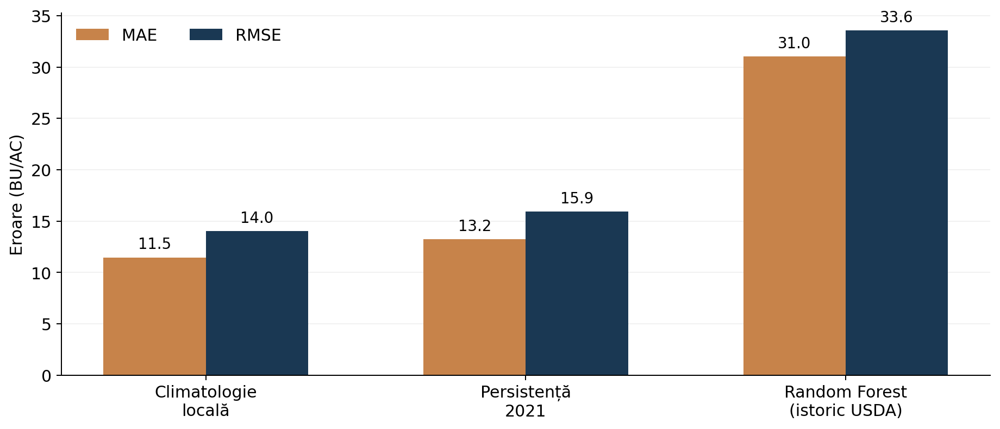

# A3 — AgriTwin
### Estimarea randamentului porumbului în Iowa

**Inteligență Computațională III · Master SIVA · Checkpoint 2**  
**Dumitru Florin-Adrian**

## Despre proiect

Proiectul urmărește estimarea randamentului porumbului la nivel de comitat (*county*) în statul Iowa, SUA. Ideea este de a obține o estimare utilă pentru planificarea veniturilor agricole înainte de recoltare, folosind datele disponibile din anii anteriori și, în etapele următoare, informații meteorologice și satelitare.

Pentru acest checkpoint am pornit de la un experiment mai simplu, bazat pe istoricul randamentului. Scopul a fost să stabilesc o referință de comparație (*baseline*) și un protocol de evaluare pe care să le pot folosi ulterior pentru modelele multimodale.

## Date utilizate

Am folosit înregistrările USDA incluse în setul de date [CropNet](https://huggingface.co/datasets/CropNet/CropNet), pentru cultura porumbului:

- **Regiune:** Iowa, SUA
- **Perioadă:** 2017–2022
- **Eșantion:** 30 de comitate cu înregistrări complete în cei șase ani
- **Unitate de analiză:** comitat × an (180 de înregistrări)
- **Variabilă prezisă:** randamentul anual al porumbului, în bushels/acru (BU/AC)

Subsetul folosit în experiment se găsește în `data/usda_corn_iowa_pilot30_2017_2022.csv`.

## Metodă și protocol experimental

Am comparat două moduri de reprezentare a istoricului: o reprezentare numerică formată din șase caracteristici (randamentele din ultimii doi ani, media și abaterea standard istorice, media ultimilor trei ani și variația dintre ultimii doi ani) și o reprezentare simplă, bazată pe media istorică a fiecărui comitat.

Au fost evaluate trei metode:

1. **Media istorică locală** — predicția este media randamentelor din anii precedenți.
2. **Persistența** — predicția este randamentul înregistrat în anul precedent.
3. **Random Forest Regressor** — model antrenat pe cele șase caracteristici istorice.

Pentru test am separat complet **anul 2022**. Modelul Random Forest este antrenat pe observațiile pentru anii-țintă 2019–2021 (90 de exemple), folosind doar informații din anii anteriori fiecărei predicții. Cele 30 de observații din 2022 sunt folosite exclusiv pentru evaluare.

Random Forest utilizează 300 de arbori, adâncime maximă 5, `min_samples_leaf=3` și `random_state=42`. Performanța este măsurată prin **MAE** și **RMSE**, ambele în BU/AC.

Aceasta este o evaluare temporală cu 2022 ca an de test, nu încă o evaluare *leave-one-year-out* completă.

## Rezultate CP2

| Metodă | MAE (BU/AC) | RMSE (BU/AC) |
|:--|--:|--:|
| **Media istorică locală** | **11,47** | **14,01** |
| Persistență | 13,22 | 15,94 |
| Random Forest | 31,04 | 33,56 |



În acest experiment, media istorică a avut cele mai mici erori. Random Forest nu a îmbunătățit rezultatul pe anul 2022, ceea ce arată că un model mai complex nu este neapărat mai potrivit pentru un eșantion mic și o reprezentare limitată la istoricul randamentelor. Rezultatul reprezintă un punct de plecare pentru comparațiile următoare, nu o concluzie despre performanța Random Forest pe datele CropNet complete.

## Rularea experimentului

Proiectul folosește Python, pandas, NumPy, scikit-learn și Matplotlib. Din directorul repository-ului:

```bash
python -m pip install -r requirements.txt
python run_cp2.py
```

Scriptul citește datele din `data/`, construiește caracteristicile, antrenează modelul și salvează rezultatele în `outputs/`:

| Fișier | Conținut |
|:--|:--|
| `metrics_2022.csv` | MAE și RMSE pentru cele trei metode |
| `predictions_2022.csv` | Valorile reale și predicțiile pentru fiecare comitat |
| `feature_matrix_2019_2022.csv` | Caracteristicile istorice calculate |
| `comparison_2022.png` | Graficul comparativ al erorilor |
| `protocol.json` | Parametrii experimentului |

## Limite și continuarea proiectului

Experimentul CP2 folosește **doar istoricul randamentelor USDA**. Datele Sentinel-2 și WRF-HRRR nu sunt încă incluse, astfel că rezultatele nu reprezintă o prognoză în timpul sezonului de vegetație. În plus, pilotul cu 30 de comitate este restrâns, iar evaluarea acoperă un singur an de test.

În etapa următoare voi verifica disponibilitatea și alinierea datelor satelitare și meteorologice pe comitat și an. Pentru predicțiile din timpul sezonului voi păstra doar observațiile disponibile până la **31 august**. Ulterior, voi compara modelele bazate pe vreme și satelit cu baseline-urile de aici și voi extinde evaluarea temporală.

## Referințe

- [CropNet — dataset](https://huggingface.co/datasets/CropNet/CropNet)
- [CropNet — repository-ul autorilor](https://github.com/fudonglin/CropNet)
- Lin et al. (2024), *An Open and Large-Scale Dataset for Multi-Modal Climate Change-aware Crop Yield Predictions*, KDD. [Articol](https://arxiv.org/abs/2406.06081)
